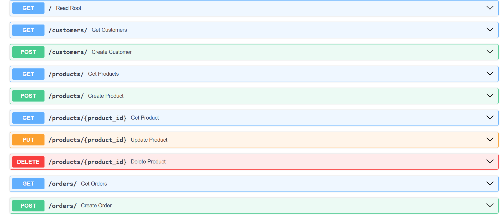

# Order Analytics System

A backend system for managing orders, products, and customers, with an integrated data pipeline for sales analytics and demand forecasting. Built with FastAPI and PostgreSQL, and designed to demonstrate backend development and data engineering fundamentals relevant to supply chain and order processing systems.

## Tech Stack
- **Backend:** Python, FastAPI, SQLAlchemy
- **Database:** PostgreSQL
- **Data Engineering:** Pandas (ETL pipeline)
- **Machine Learning:** Scikit-learn (demand forecasting)
- **Frontend:** HTML, CSS, JavaScript, Chart.js (dashboard)
- **Testing and tooling:** Pytest, Docker, Git

## Features
- Full CRUD API for Products, Customers, and Orders (with nested order items)
- Relational database schema with proper foreign key relationships
- ETL pipeline that ingests raw CSV sales data, cleans it, and aggregates it into daily sales totals
- Analytics API endpoint exposing aggregated sales data
- Simple linear regression model to forecast sales for the next 7 days
- Interactive dashboard with sales charts, a 7-day moving average, product search, and low-stock alerts
- Automated API tests with Pytest
- Dockerfile for containerization

## API Screenshots

### Interactive API documentation (Swagger UI), part 1

### Interactive API documentation (Swagger UI), part 2

## API Endpoints
| Method | Endpoint | Description |
|--------|----------|-------------|
| POST | /products/ | Create a product |
| GET | /products/ | List all products |
| GET | /products/{id} | Get a single product |
| PUT | /products/{id} | Update a product |
| DELETE | /products/{id} | Delete a product |
| POST | /customers/ | Create a customer |
| GET | /customers/ | List all customers |
| POST | /orders/ | Create an order with items |
| GET | /orders/ | List all orders |
| GET | /orders/{id} | Get a single order |
| GET | /analytics/daily-sales | Get aggregated daily sales |

## Setup
1. Create a virtual environment: `python -m venv venv`
2. Activate it: `venv\Scripts\activate` (Windows) or `source venv/bin/activate` (Mac/Linux)
3. Install dependencies: `pip install -r requirements.txt`
4. Create a PostgreSQL database named `order_system` and update the connection string in `database.py`, `etl.py`, and `forecast.py`
5. Start the server: `uvicorn main:app --reload`
6. Open `http://127.0.0.1:8000/docs` for interactive API documentation
7. In a second terminal, run `python etl.py` to load and aggregate the sales data (needed for the analytics endpoint and dashboard)
8. Run `python forecast.py` to generate a 7-day sales forecast
9. Open `dashboard.html` in a browser (the API server must be running)
10. Run the tests with `pytest -v`

## Project Structure
- `main.py` - FastAPI application and API routes
- `models.py` - SQLAlchemy database models
- `schemas.py` - Pydantic request/response schemas
- `database.py` - Database connection setup
- `etl.py` - ETL pipeline for sales data
- `forecast.py` - Demand forecasting model
- `dashboard.html` - Interactive dashboard
- `test_main.py` - Pytest API tests
- `Dockerfile`, `requirements.txt` - Containerization and dependencies
- `retail_sales_dataset.csv` - Sample sales data
- `screenshots/` - Images used in this README

## Dataset
Sample sales data from the [Retail Sales Dataset](https://www.kaggle.com/datasets/mohammadtalib786/retail-sales-dataset) on Kaggle by Mohammad Talib.

## Limitations and Future Improvements
- Database credentials are hardcoded for local development and should move to environment variables
- No authentication yet (JWT planned)
- Order creation does not yet validate all items before saving, and does not update stock levels
- The forecasting model is a simple linear regression; time-series models (ARIMA, Prophet) or day-of-week features would improve accuracy
- Endpoints are not paginated

- **🔗 [Live Dashboard Demo](https://ishanii22.github.io/order-analytics-system/)** (static snapshot; the full app runs locally with FastAPI + PostgreSQL)
